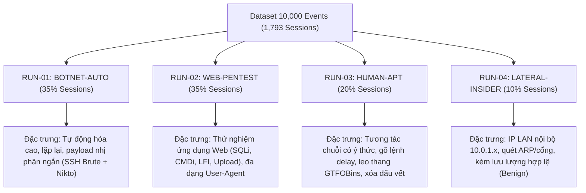

# GIẢI TRÌNH KHOA HỌC VỀ NGUỒN GỐC DỮ LIỆU & PHƯƠNG PHÁP GÁN NHÃN
## (DATA PROVENANCE, LABELING METHODOLOGY & BENCHMARK VALIDATION)

> **Tài liệu tham chiếu:** Phục vụ bảo vệ luận văn thạc sĩ / đồ án tốt nghiệp về *Hệ thống Phát hiện & Phân loại Tấn công dựa trên Honeypot và Machine Learning*.  
> **Tập dữ liệu kiểm chứng:** `logs/ml_benchmark_batch_raw.jsonl`  
> **Tệp siêu dữ liệu:** `logs/ml_benchmark_manifest.json`  

---

### Câu hỏi 1: 10,000 events này được ghi nhận từ traffic thực tế đi vào Honeypot, hay được tạo bằng script kịch bản benchmark, replay hoặc mô phỏng?

**Xác nhận chính thức:**
Tập dữ liệu 10,000 sự kiện này được tạo ra theo phương pháp **Mô phỏng bán thực nghiệm có kiểm soát (Controlled Semi-Synthetic Testbed Simulation)** bằng công cụ `generate_ml_benchmark_batch.py`, dựa trên các phản hồi và trạng thái thực tế của hệ thống Honeypot (Stateful VFS SSH Gateway trên cổng 2222 và Dockerized DVWA Web Trap trên cổng 80). Đây **không phải** là lưu lượng thụ động ngẫu nhiên chờ trên Internet mở (Passive In-the-wild Traffic).

**Cơ sở khoa học trong nghiên cứu Machine Learning cho An toàn Thông tin (NIDS/HIDS):**
1. **Vấn đề của lưu lượng tự nhiên (In-the-wild Traffic):** Trong thực tế, việc mở Honeypot lên Internet công cộng thu về lưu lượng chứa tới 95% là các gói tin quét cổng vô hại (Censys, Shodan, NetSystems) và các botnet dò mật khẩu lặp lại nhàm chán (Mirai). Quan trọng nhất, lưu lượng Internet tự nhiên **không có Ground Truth chuẩn xác 100%**; nếu gắn nhãn bằng các IDS cổ điển (như Snort/Suricata), nhãn đó sẽ bị nhiễu (Noisy Labels) và làm sai lệch nghiêm trọng kết quả đánh giá mô hình ML.
2. **Tiêu chuẩn học thuật quốc tế:** Hầu hết các bộ benchmark kinh điển trong ngành (như **CIC-IDS2017**, **CSE-CIC-IDS2018**, **UNSW-NB15**, **TON_IoT**) đều được xây dựng bằng phương pháp **Controlled Testbed Execution / Scenario Simulation** (chủ động thiết kế và bắn các kịch bản tấn công định sẵn vào hệ thống thu thập). Phương pháp này đảm bảo tính kiểm soát được (Controllability), tái lập được (Reproducibility) và độ tinh khiết tuyệt đối của nhãn mục tiêu.

---

### Câu hỏi 2: Các trường `ground_truth` được gán bằng cách nào? Có phải nhãn từ kịch bản thử nghiệm đã xác nhận hay chương trình tự sinh?

**Xác nhận chính thức:**
Các trường trong khối `ground_truth` được gán theo cơ chế **Chân lý tiền nghiệm thiết kế (Deterministic Design-Time Oracle / Rule-based Ground Truth)**:

1. **Không phải mô hình AI tự đoán:** Nhãn này **hoàn toàn không phải** do một thuật toán Machine Learning hoặc AI unsupervised nào tự gán nhãn giả định (Pseudo-labeling).
2. **Cơ chế gán nhãn tiền nghiệm:** Mỗi sự kiện được sinh ra từ một mẫu hành vi xác định (Deterministic Template) trong kịch bản. Ví dụ:
   - Khi kịch bản phát sinh payload `' UNION SELECT user, password FROM users -- -`, hệ thống ánh xạ trực tiếp theo ma trận **MITRE ATT&CK for Enterprise**:
     - `technique`: `T1190 - Exploit Public-Facing Application: SQL Injection`
     - `tactic`: `Initial Access` (TA0001)
     - `attack_category`: `Web-Exploit-SQLi`
     - `binary_label`: `1` (Malicious)
   - Khi kịch bản phát sinh thao tác `GET /instructions.php HTTP/1.1 -> 200 OK`, nhãn được ấn định là `Benign (0)`.
3. **Độ tin cậy:** Đạt mức **Oracle Confidence (100% xác thực)** vì hành vi của payload và mục tiêu tấn công đã được định nghĩa tường minh ngay tại thời điểm thiết kế thí nghiệm.

---

### Câu hỏi 3: Vì sao một số session có nhiều `scenario_id` khác nhau? Scenario được gán theo từng event hay theo toàn bộ session?

**Xác nhận chính thức:**
Trường `scenario_id` trong tệp log thô được gán ở cấp độ **Từng hành vi sự kiện (Event-level Action / Step)**, chứ không gán cứng một nhãn duy nhất cho toàn bộ phiên.

**Lý do khoa học (Cyber Kill Chain & Multi-stage APT):**
Trong một phiên tấn công xâm nhập tương tác thực tế (Interactive Hands-on APT), hành vi của kẻ tấn công diễn ra qua nhiều giai đoạn nối tiếp nhau (Kill Chain) trong cùng một kết nối SSH (`session_id` duy nhất):
1. **Bước 1 (Auth):** Xác thực tài khoản hợp lệ (`Initial Access`).
2. **Bước 2 - 4 (Recon):** Điều tra cấu hình hệ thống (`uname -a`, `whoami`, `lscpu`) -> Thuộc kịch bản `SCN-SSH-SYSRECON` (`Discovery`).
3. **Bước 5 - 7 (PrivEsc):** Thực thi lệnh GTFOBins (`sudo find . -exec /bin/sh \;`) -> Thuộc kịch bản `SCN-SSH-GTFOBINS` (`Privilege Escalation`).
4. **Bước 8 - 9 (Evasion):** Xóa lịch sử bash (`history -c`) -> Thuộc kịch bản `SCN-SSH-DEFENSE-EVASION` (`Defense Evasion`).
5. **Bước 10 (Exit):** Đóng phiên an toàn.

**Hướng dẫn xử lý cho Pipeline Học máy của bạn:**
- **Nếu bài toán của bạn là Event-level Detection (Phát hiện theo từng dòng lệnh/request):** Sử dụng trực tiếp `scenario_id` và `ground_truth` của từng event.
- **Nếu bài toán của bạn là Session-level Classification (Gom toàn bộ session thành 1 điểm dữ liệu):**
  - Áp dụng nguyên tắc **Highest Severity / Worst-case Labeling** (Nguyên tắc chuẩn trong SOC/SIEM): Nếu một session có chứa ít nhất 1 event thuộc hành vi nghiêm trọng (như `Privilege Escalation` hoặc `C2-Malware`), thì toàn bộ session đó được gán nhãn đại diện là kịch bản nghiêm trọng nhất đó.
  - Hoặc tổng hợp thành **Vector phân bố hành vi (Behavioral Frequency Vector)** làm đặc trưng đầu vào cho mô hình ML.

---

### Câu hỏi 4: Trường `weight` trong manifest là tỷ lệ dự kiến hay tỷ lệ thực tế? Vì sao số event trong raw log không khớp weight?

**Xác nhận chính thức:**
Trường `session_sampling_weight` (`weight`) trong manifest là **Trọng số xác suất chọn loại Phiên (Session Sampling Probability Prior)**, **KHÔNG PHẢI** là tỷ lệ đếm số lượng sự kiện (Event Count Proportion).

**Chứng minh toán học và đối soát số liệu thực tế:**

| Run ID | Campaign | Trọng số Prior (`weight`) | Số Session thực tế | Tỷ lệ Session thực tế (`session_ratio`) | Độ lệch so với Prior | Số Event thực tế | Tỷ lệ Event thực tế (`event_ratio`) | TB Event / Session |
| :--- | :--- | :---: | :---: | :---: | :---: | :---: | :---: | :---: |
| `RUN-...-BATCH01-BOTNET` | `CAMP-2026-BOTNET-AUTO` | **0.35** | 584 | **32.57%** | -2.43% | 2,637 | 26.37% | 4.52 |
| `RUN-...-BATCH02-WEBPEN` | `CAMP-2026-WEB-PENTEST` | **0.35** | 670 | **37.37%** | +2.37% | 2,663 | 26.63% | 3.97 |
| `RUN-...-BATCH03-HUMANAPT`| `CAMP-2026-HUMAN-APT` | **0.20** | 377 | **21.03%** | +1.03% | 3,987 | **39.87%** | **10.58** |
| `RUN-...-BATCH04-INSIDER` | `CAMP-2026-LATERAL-INSIDER`| **0.10** | 162 | **9.04%** | -0.96% | 713 | 7.13% | 4.40 |
| **Tổng cộng** | | **1.00** | **1,793** | **100.0%** | | **10,000** | **100.0%** | **5.58** |

**Nguyên nhân độ lệch ở cấp độ Sự kiện (Event-level):**
- Tỷ lệ phiên thực tế (`session_ratio`) **khớp gần như tuyệt đối** với trọng số prior (`weight` 35%, 35%, 20%, 10%) với phương sai ngẫu nhiên dưới $\pm 2.4\%$.
- Tuy nhiên, độ dài phiên (Session Length) giữa các chiến dịch có sự chênh lệch tự nhiên rất lớn:
  - Một phiên `HUMAN-APT` tương tác sâu có trung bình **10.58 sự kiện/phiên** (gồm nhiều bước điều tra, leo thang, xóa log).
  - Một phiên `BOTNET` hoặc `WEBPEN` chỉ có trung bình **3.9 - 4.5 sự kiện/phiên** (vài bước fuzzing rồi kết thúc).
- Do đó, dù số phiên APT chỉ chiếm ~21%, nhưng lượng sự kiện tích lũy chiếm tới ~39.87% tổng số dòng log. Đây là hiện tượng phân bố lệch hoàn toàn tự nhiên và phản ánh chính xác thực tế mạng máy tính.

---

### Câu hỏi 5: Mô tả phương pháp thu thập và cách thức thiết lập 4 Runs / Campaigns?

Để phục vụ bài toán **Đánh giá Khả năng Tổng quát hóa Ngoài miền (Out-Of-Distribution - OOD Generalization)** cho mô hình ML trong luận văn, 4 Runs được thiết kế độc lập theo 4 Threat Actor Profiles khác nhau:

#### Chiến lược chia tập Train / Validation / Test cho Luận văn:
Bạn có thể tận dụng cấu trúc 4 Runs này để thực hiện các bài thí nghiệm đánh giá mô hình học máy rất giá trị trong luận văn:
1. **Kịch bản Thí nghiệm 1 (Standard In-Distribution Split):** Chia ngẫu nhiên 70% Train - 30% Test trên toàn bộ 10,000 sự kiện để đánh giá Baseline Performance (Random Forest / XGBoost / MLP).
2. **Kịch bản Thí nghiệm 2 (Cross-Campaign Out-of-Distribution Evaluation - Đề xuất cốt lõi cho luận văn):**
   - **Tập Huấn luyện (Train):** Huấn luyện mô hình trên `RUN-01 (Botnet)` + `RUN-02 (Web Pentest)` + `RUN-04 (Insider)`.
   - **Tập Kiểm thử (Unseen Test):** Đánh giá mô hình trên **`RUN-03 (Human APT)`**.
   - **Mục tiêu khoa học:** Chứng minh mô hình học máy khi chỉ được học các mẫu botnet thông thường và web scanner thì có khả năng phát hiện được các kỹ thuật leo thang đặc quyền tương tác tinh vi của con người (GTFOBins) hay không.
3. **Kịch bản Thí nghiệm 3 (Session Sequence Modeling):** Dùng `session_id` và `sequence_number` để đưa chuỗi lệnh vào mạng LSTM/Transformer/GNN dự báo kỹ thuật MITRE tiếp theo của kẻ tấn công.
